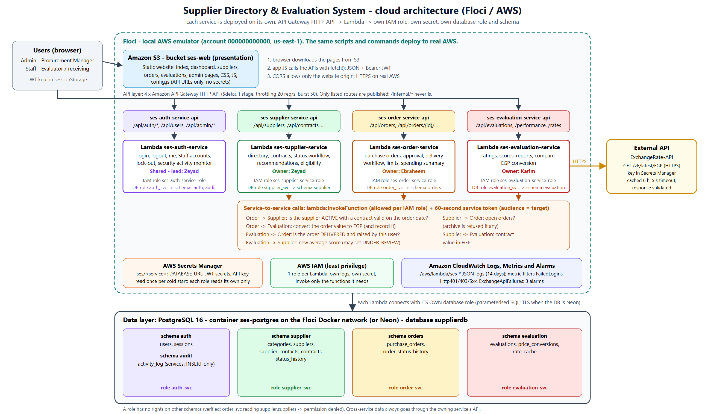

# Supplier Directory & Evaluation System — Group 26

Cloud Computing and Cloud Security (26CSCN29H), final phase.

A cloud web application for procurement teams. It keeps the supplier directory and contracts in one place, controls purchase orders with business rules, and converts every value to EGP with live exchange rates. Post-delivery ratings become supplier scores, and those scores decide which suppliers may receive orders.

| Service | Owner | Lambda / API | Main functions |
|---|---|---|---|
| Supplier Service | Zeyad Ahmed (239924) | `ses-supplier-service` | create, search/filter, update and view suppliers; contracts (overlap rule, EGP); status workflow with automatic review; recommendations; archiving (blocked while orders are open) |
| Order Service | Ebraheem Mohamed (249043) | `ses-order-service` | purchase orders with eligibility check, contract limit and approval threshold; list/filter; delivery workflow (on time / days late); approve or reject (never your own order); spending summary; conversion retry |
| Evaluation Service | Karim Hisham (249581) | `ses-evaluation-service` | rate delivered orders (once, weighted score); history; edit or delete within 7 days; performance report; compare suppliers; ExchangeRate API conversion |
| Auth Service (shared) | lead: Zeyad | `ses-auth-service` | login/logout/me, Admin-created Staff accounts, lock-out, security monitoring |

Service-to-service calls: Order→Supplier (eligibility), Order→Evaluation (convert to EGP), Evaluation→Order (delivered? owner?), Evaluation→Supplier (new score), Supplier→Order (open orders), Supplier→Evaluation (contract EGP). Each service has its own PostgreSQL role and schema.



## Repository layout

```
services/            backend (Node.js + Express; same code runs locally and on AWS Lambda)
  shared/            auth middleware, logging, validation, DB access, service-to-service client
  auth-service/      supplier-service/   order-service/   evaluation-service/
frontend/            HTML/CSS/JS website (pages/*.body.html -> scripts/build-pages.js)
database/            schemas, per-service roles and grants, seed
infra/               Floci docker-compose, IAM policies, routes, deploy/monitoring/destroy scripts
scripts/             local runner, DB setup, demo seed, packaging, secret scan, log query, screenshots
tests/               functional + integration + security, resilience, packaged-Lambda tests
evidence/            test results, log/monitoring report, screenshots (generated)
docs/                report, diagrams, Floci setup, team handover, recovery
```

## Run locally (no Docker needed)

```powershell
npm run setup
```

```powershell
npm run local
```

This starts PostgreSQL (embedded), creates the per-service roles, runs the four services on ports 4001–4004, and serves the website at http://localhost:8080. The first run creates `.env.local` with random secrets and the first Admin login (git-ignored).

In a second terminal:

```powershell
npm run seed:demo
```

```powershell
npm run test:all
```

## Deploy to Floci (AWS emulator)

See [docs/DOCKER_FLOCI_SETUP.md](docs/DOCKER_FLOCI_SETUP.md). In short (Git Bash):

```bash
bash infra/deploy.sh all            # everything
bash infra/deploy.sh order-service  # one service (each student deploys their own)
bash infra/check-deploy.sh
```

## Security notes

- Never commit `.env*` files (only the `*.example` files are tracked). Run `npm run secret-scan` before pushing.
- Roles are enforced in the backend (`requireRole`, ownership checks). Hiding a button in the UI is only a convenience.

## Report

`npm run report` builds `docs/report/Group26_Final_Report.docx` from the evidence files.
